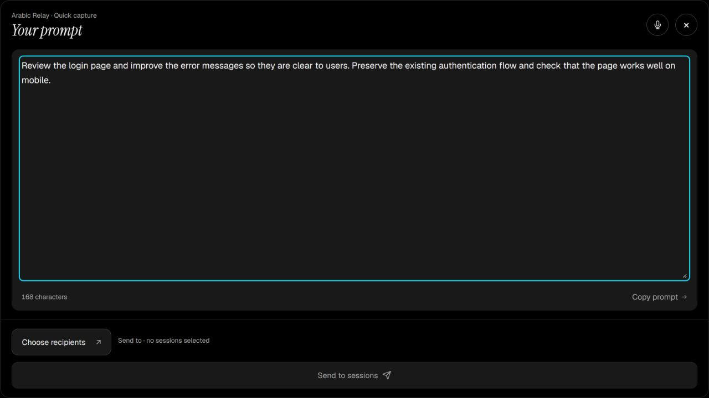

# Arabic Relay

**اتكلم بالعربي والإنجليزي، راجع البرومبت، وابعته لجلسة البرمجة اللي تختارها.**

[تحميل نسخة Windows](https://github.com/Mahmoud6901/arabic-relay/releases/latest) ·
[English](README.md) · [شاركنا تجربتك](https://github.com/Mahmoud6901/arabic-relay/issues/new?template=first_use_feedback.yml)

Arabic Relay تطبيق مجاني ومفتوح المصدر لمطوري Windows اللي بيستخدموا العربي والإنجليزي مع بعض.
اتكلم أو اكتب فكرتك، راجع النص الإنجليزي وعدّله، وبعدها ابعته لجلسة أو أكتر في **T3 Code أو Codex أو Claude Code**.
تقدر كمان تنسخ البرومبت وتستخدمه في أي أداة تانية.

**اتكلم ← جهّز البرومبت ← راجع وعدّل ← اختار الجلسات ← اضغط Send.**
التسجيل وتجهيز البرومبت مش بيبعتوا حاجة للجلسات تلقائيًا.

*صورة للواجهة الحالية بنص تجريبي مكتوب. مفيش مستلمين مختارين، ومفيش رسالة اتبعتت.*

## أختار أنهي وضع؟

| الوضع | بيعمل إيه؟ | تستخدمه إمتى؟ |
|---|---|---|
| **Craft a prompt** | بيحوّل ملاحظاتك العربي والإنجليزي لتعليمات إنجليزية منظمة مع الحفاظ على قصدك والقيود اللي قلتها. | لما تشرح مهمة أو تفكر بصوت عالي. |
| **Inline translation** — نسخة تجريبية | بيترجم العبارات العربية، ويحافظ على النص الإنجليزي الموجود خارجها زي ما هو. | لما تكون عايز تحتفظ بصياغتك وتترجم العربي بس. |

في الوضعين، النص اللي ظاهر قدامك في المحرر هو اللي بيتبعت بعد ضغط **Send**.
التعرف على الكلام والترجمة ممكن يغلطوا؛ راجع أسماء الملفات والمصطلحات والتعليمات قبل الإرسال.

مثال توضيحي: «راجع صفحة الـ login وحسّن الـ error messages من غير ما تغيّر الـ authentication flow.»

ممكن تكون النتيجة:

> Review the login page and improve the error messages without changing the authentication flow.

ده مثال توضيحي، مش وعد بدقة ثابتة لكل تسجيل.

## ابدأ في أربع خطوات

1. نزّل `ArabicRelay-Setup-<version>.exe` من [آخر إصدار](https://github.com/Mahmoud6901/arabic-relay/releases/latest) وثبّته. التثبيت للمستخدم الحالي ومش محتاج صلاحيات مسؤول.
2. اختار طريقة الإملاء: Whisper المحلي، أو Cohere، أو Wispr Flow. لتجهيز البرومبت، ثبّت Codex CLI أو Claude Code وسجّل الدخول بحسابك.
3. اختار **Craft a prompt** أو **Inline translation**، واتكلم أو اكتب، وبعدها راجع النتيجة وعدّلها.
4. من **Settings** وصّل T3 أو جلسات البرمجة المحلية، اختار المستلمين، واضغط **Send**. تقدر تجرب تجهيز ونسخ البرومبت من غير ربط أي جلسة.

## المتطلبات والتكلفة

- Windows 10 أو 11 بنظام 64-bit. المثبّت بيضيف Microsoft Edge WebView2 لو مش موجود.
- نموذج Whisper المحلي محتاج تحميل أول مرة بحجم حوالي 1.6–3.1 GB، ومساحة متاحة حوالي 2–4 GB.
- كارت NVIDIA اختياري. تشغيل GPU ممكن يحتاج تحميل cuBLAS إضافي بحجم حوالي 553 MB. السرعة بتختلف حسب الجهاز والنموذج وطول التسجيل.
- [Codex CLI](https://developers.openai.com/codex/cli) أو [Claude Code](https://code.claude.com/docs/en/overview) مع تسجيل دخول لتجهيز البرومبت والترجمة.
- التطبيق نفسه مجاني بترخيص MIT، لكن خدمات الذكاء الاصطناعي والإملاء الخارجية لها حساباتها وأسعارها وحدود استخدامها. Cohere يحتاج مفتاح API الخاص بك.
- مفيش إضافة متصفح مطلوبة. محادثات ChatGPT وClaude العادية مش ضمن المستلمين؛ الدعم لجلسات البرمجة المحلية الموجودة.

## نافذة Quick capture

سيب Relay شغّال، حتى لو مصغّر، واستخدم الاختصار المختار في **Settings → Quick capture**.
الاختيارات هي **Ctrl + Alt + Space** أو **Ctrl + Alt + R** أو **Ctrl + Shift + Space**.
لو برنامج تاني حجز الاختصار، اختار غيره أو استخدم زر **Quick capture**.

مع Whisper أو Cohere، الاختصار بيفتح شريط التسجيل ويبدأ الميكروفون. اضغطه تاني أو اضغط Stop لتجهيز البرومبت.
مع Wispr Flow، افتح نافذة Relay الأول، وبعدها استخدم اختصار Flow نفسه علشان يكتب جوّاها.
Relay مش بيلتقط اختصار Flow ومش بيتحكم في ميكروفونه.

بعد التجهيز، راجع البرومبت، واضغط **Choose recipients** لاختيار الجلسات، وبعدها **Send**.
مسودة النافذة مستقلة عن مساحة العمل الرئيسية. **Keep draft** يحتفظ بها، و**Discard draft** يتخلّص منها.

## ربط جلسات البرمجة

- **Codex:** من **Settings → Direct coding sessions → Connect Codex**. الرسالة تدخل طابور الجلسة المختارة؛ افتح الجلسة في Codex لمعالجتها.
- **Claude Code:** اضغط **Connect Claude Code**، وبعدها افتح الجلسة المطلوبة من جديد أو ابعت فيها رسالتك التالية، ثم حدّث القائمة. الربط بيضيف hooks خاصة بـ Relay مع الاحتفاظ بالإعدادات ونسخة احتياطية.
- **T3 Code:** وصّله من Settings، ثم اختار المشروع والجلسات المتاحة.

الجلسة المشغولة ممكن تتأخر في تأكيد الاستلام. لو النتيجة غير مؤكدة، راجع الجلسة قبل ما تعيد الإرسال.
تأكيد الاستلام مش معناه إن وكيل البرمجة خلّص المهمة. جلسات WSL وSSH والسحابة غير مدعومة في الربط المحلي.

## الخصوصية

| الميزة | المعالجة فين؟ |
|---|---|
| Whisper المحلي | الصوت بيتحوّل لنص على جهازك. |
| Cohere أو Wispr Flow | معالجة صوت أونلاين عند مزوّد الخدمة المختار. |
| تجهيز البرومبت وتصحيح الإنجليزية وترجمة العبارات | النص بيروح لمزوّد Codex أو Claude Code بحسابك. الخيارات التلقائية وQuick capture ممكن تعمل ده قبل المراجعة. |
| إرسال البرومبت | بضغطتك على Send؛ جلسة البرمجة بتستخدم مزوّدها وصلاحياتها. |
| السجل والإعدادات | محفوظة محليًا. مفيش تحليلات استخدام أو إرسال تلقائي لتقارير الأعطال. |

**History** بيحتفظ بآخر 20 برومبت إنجليزي تم إرساله، مع وقت الإرسال وأسماء المستلمين. مش بيحفظ الصوت أو المسودات اللي متبعتتش.
راجع [سياسة الخصوصية الكاملة](PRIVACY.md) لمعرفة الاتصالات والبيانات وخيارات الحذف.

## توقيع التطبيق والتحديثات

الإصدارات لحد v0.3.0 فيها توقيع تتحقق منه أداة التحديث داخل Relay، لكن لسه مفيش توقيع ناشر Windows Authenticode.
ممكن Windows يعرض تحذير ناشر غير معروف أو SmartScreen. طلب SignPath Foundation اتقدّم يوم 1 نوفمبر 2026، والموافقة لسه منتظرة.
اقرأ [سياسة توقيع الكود](CODE_SIGNING.md)، وقارن SHA-256 بملف `SHA256SUMS.txt` الموجود في صفحة الإصدار عند التحقق من التنزيل.

التحديثات تلقائية افتراضيًا، وتقدر تختار **Notify only** أو **Off** من **Settings → About**.

## ساعدنا نحسّن التطبيق

جرّبه في مهمة واحدة و[شاركنا النتيجة](https://github.com/Mahmoud6901/arabic-relay/issues/new?template=first_use_feedback.yml):
التثبيت كان واضح؟ المصطلحات اتعرفت صح؟ وصلت للجلسة المقصودة؟ تقدر تكتب ملاحظاتك بالعربي أو الإنجليزي.
متنشرش تسجيلات أو برومبتات خاصة أو مفاتيح وصول أو أسماء جلسات حساسة في التقارير العامة.

لو Arabic Relay ساعدك، ممكن تعمل **Star** للمستودع علشان ناس تانية تكتشفه.
للمساهمة في الكود أو التوثيق، اقرأ [دليل المساهمة](CONTRIBUTING.md). ترخيص المشروع [MIT](LICENSE).
