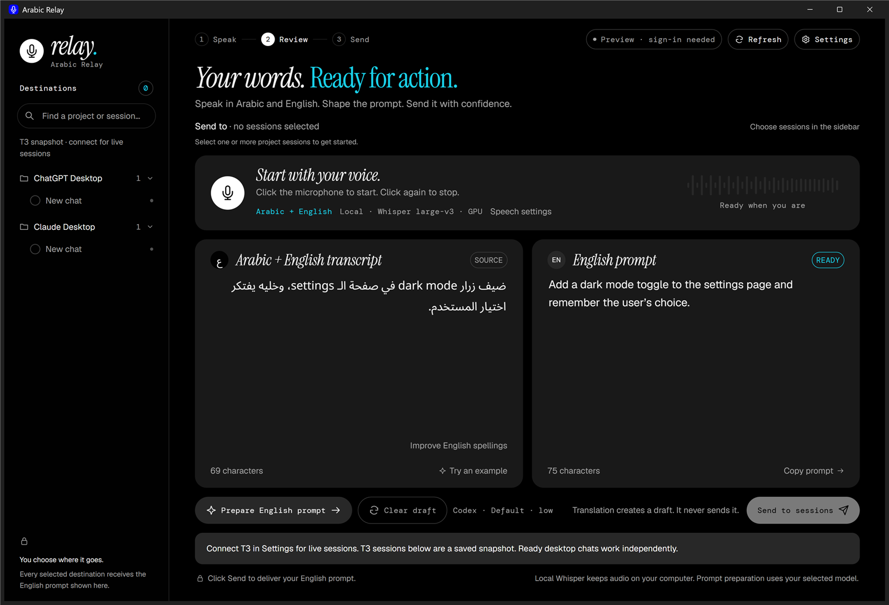

# Arabic Relay

Dictate in Arabic, mixed with the English terms you already use, and get a clean English prompt for your AI coding
tools. Arabic Relay transcribes your voice on your own computer with Whisper, turns the transcript into an English
prompt with Codex CLI or Claude Code (your own sign-in), and sends it only when you click Send: to T3 Code sessions, a
ChatGPT or Claude browser conversations, or your clipboard.



## Install

1. Download `ArabicRelay-Setup-<version>.exe` from the
   [latest release](https://github.com/Mahmoud6901/arabic-relay/releases/latest).
2. Run it. No admin rights are needed; it installs for your Windows user only.
3. On first launch, Arabic Relay checks your computer and downloads the speech model (1.6–3.1 GB, once).

**Windows SmartScreen.** Version 0.1 is not code-signed yet, so Windows may say it "protected your PC". Click
**More info → Run anyway**. To check that your download is the published one, compare its checksum with
`SHA256SUMS.txt` on the release page:

```powershell
Get-FileHash .\ArabicRelay-Setup-0.1.0.exe -Algorithm SHA256
```

Updates install automatically and are verified with the project's signing key before they run. You can switch to
"Notify only" or "Off" in **Settings → About**.

## Requirements

- Windows 10 or 11, 64-bit. Microsoft Edge WebView2 (the installer adds it if it is missing).
- About 2–4 GB of free disk space for the speech model.
- An NVIDIA GPU is optional. With one, speech runs on the GPU (Arabic Relay downloads NVIDIA's cuBLAS library, 553 MB,
  once). Without one, it runs on the CPU and takes a few seconds per sentence.
- [Codex CLI](https://developers.openai.com/codex/cli) or [Claude Code](https://code.claude.com/docs/en/overview),
  signed in, to prepare English prompts. Without either, you can still dictate and type English yourself.
- Optional: [Wispr Flow](https://wisprflow.ai) or a Cohere API key as other ways to dictate. Not affiliated.

## Privacy

Your voice is transcribed on your computer. The transcript goes to OpenAI or Anthropic only when you prepare an
English prompt, through your own Codex or Claude Code sign-in. There is no telemetry. Read [PRIVACY.md](PRIVACY.md)
for every connection the app makes and what Copy diagnostics contains.

## ChatGPT and Claude conversations

The optional Chrome companion automatically lists conversation titles and exact links from your signed-in pages.
You can select several conversations alongside T3 sessions. Sending opens each selected conversation in a new tab,
checks that its message box is empty, inserts the English prompt, verifies the destination again, and clicks Send
once. A browser submission is not a provider delivery receipt; check the conversation for its response. Uncertain
submissions are never retried automatically.

1. In desktop Relay, open **Settings → Browser conversations → Open companion folder**.
2. In Chrome, open **Extensions → Manage extensions**, enable **Developer mode**, choose **Load unpacked**, and
   select the folder Relay opened. This companion is bundled source, not a Chrome Web Store extension.
3. Click **Get pairing code** in Relay. Open the companion from Chrome's Extensions menu and paste the code.
4. Click **Open ChatGPT & Claude** in the companion. Sign in yourself if needed. Existing tabs opened before
   installing the companion need to be reloaded once.

Relay refreshes the list automatically while those pages are open. Discovery covers conversations currently
loaded in navigation or search results, plus the open conversation. It is not a full account export: load older
chats by scrolling or searching in the site. Browser-visible Claude Code sessions are included; offline sessions
are disabled. Local-only Codex and Claude Code desktop sessions are **not** exposed by this connection.

Pairing lasts until **Disconnect browser** in Relay Settings or a replacement pairing. Only one browser profile
is paired at a time. The native desktop service uses `127.0.0.1:8791`; the development preview on port 8788 is separate.

## Your data

Settings, learned vocabulary and the speech model live in `%LOCALAPPDATA%\Arabic Relay`. Uninstalling asks whether to
delete them; the default keeps them.

**History** in the top bar keeps the latest 20 sent English prompts on this computer, with send time and destination
names. It imports previous accepted sends where available. Read, copy, or use a prompt again without sending it.
Using it again clears recipients and asks before replacing an existing draft. Delete and Clear history both ask
for confirmation. Unsent drafts, failed sends, and audio are not added to history.

While recording, **Stop & transcribe** keeps your words. **Cancel recording** discards that recording and keeps any
text already in the editor.

Longer recordings use GPU batching with local Whisper. Cohere recordings over two minutes can be processed in
sections at quiet pauses, with at most two requests at once. Short Cohere recordings stay as one request. Processing
still begins after you stop recording; the selected speech model and Arabic/English support stay the same.

## Install with pip (developers)

```powershell
pip install "arabic-relay[gpu] @ git+https://github.com/Mahmoud6901/arabic-relay"
arabic-relay
```

Leave out `[gpu]` on computers without an NVIDIA GPU. Python 3.12 or newer.

## Build from source

See [CONTRIBUTING.md](CONTRIBUTING.md). In short: `pip install -e .[build]`, install
[Inno Setup 6](https://jrsoftware.org/isinfo.php), then run `scripts\build.ps1`.

## Report a problem

Open **Settings → About → Copy diagnostics** and paste the result into a
[bug report](https://github.com/Mahmoud6901/arabic-relay/issues/new?template=bug_report.yml). It contains versions and
paths, never your transcripts or audio.

## License

[MIT](LICENSE). Fonts are under the SIL Open Font License (see `src/arabic_relay/fonts/`).
