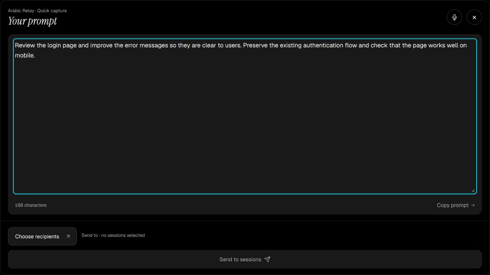

# Arabic Relay

**Speak Arabic and English. Review a clear English prompt. Send it to your coding session.**

[Download for Windows](https://github.com/Mahmoud6901/arabic-relay/releases/latest) ·
[العربية](README.ar.md) · [First-use feedback](https://github.com/Mahmoud6901/arabic-relay/issues/new?template=first_use_feedback.yml)

Arabic Relay is a free, MIT-licensed Windows desktop app for developers who think and speak in Arabic while
working with English coding tools. Dictate or type your notes, review the result, and send it to one or more
**T3 Code, Codex, or Claude Code sessions**. You can also copy the prompt into another tool.

**Speak → prepare → review/edit → choose sessions → Send.** Recording and preparation never send to a session automatically.



*Current Quick capture review interface, shown with a typed example. No destination is selected and nothing was sent.*

## Which mode should I choose?

| Mode | What happens | Best for |
|---|---|---|
| **Craft a prompt** | Turns Arabic/English notes into organized English instructions, preserving your intent and constraints. | Speaking through a task or idea. |
| **Inline translation** *(preview)* | Translates Arabic phrases while preserving the existing English text outside those phrases. | Keeping your wording and translating only the Arabic parts. |

Both modes let you edit first and send the exact text shown. Recognition and translation can make mistakes;
review names, technical terms, and instructions before sending.

For example, you might say: «راجع صفحة الـ login وحسّن الـ error messages من غير ما تغيّر الـ authentication flow.»
A possible English result is: “Review the login page and improve the error messages without changing the authentication flow.”
This is an illustrative example, not an accuracy guarantee.

## Try it in four steps

1. **Install** the Windows app from [GitHub Releases](https://github.com/Mahmoud6901/arabic-relay/releases/latest).
2. **Choose your tools.** Use local Whisper or an optional speech provider. Install and sign in to Codex CLI or Claude Code for prompt preparation.
3. **Speak or type.** Choose Craft a prompt or Inline translation, then review and edit the English result.
4. **Choose a destination.** Connect T3 or local coding sessions in Settings, select recipients, and click Send. You can try preparation and Copy prompt before connecting a destination.

**Before downloading:** Windows 10/11 x64; local speech models need a one-time download and disk space.
AI prompt preparation uses your own Codex/Claude Code login and its usage limits. Relay is not a fully offline AI writer.
Regular ChatGPT and Claude conversations are not selectable destinations; existing local coding sessions are supported.

## Install

1. Download `ArabicRelay-Setup-<version>.exe` from the
   [latest release](https://github.com/Mahmoud6901/arabic-relay/releases/latest).
2. Run it. No admin rights are needed; it installs for your Windows user only.
3. On first launch, Arabic Relay checks your computer and downloads the speech model (1.6–3.1 GB, once).

**Windows publisher signing.** Releases through v0.3.0 do not yet have a Windows Authenticode publisher signature,
so Windows may display an unknown-publisher or SmartScreen warning. The SignPath Foundation application was
submitted on 1 November 2026; approval is pending. See the [Code signing policy](CODE_SIGNING.md).
To check that your download is the published one, compare its checksum with
`SHA256SUMS.txt` on the release page:

```powershell
Get-FileHash .\ArabicRelay-Setup-0.3.0.exe -Algorithm SHA256
```

Updates install automatically and are verified with the project's signing key before they run. You can switch to
"Notify only" or "Off" in **Settings → About**.

## Requirements

- Windows 10 or 11, 64-bit. Microsoft Edge WebView2 (the installer adds it if it is missing).
- About 2–4 GB of free disk space for the speech model.
- An NVIDIA GPU is optional. With one, speech runs on the GPU (Arabic Relay downloads NVIDIA's cuBLAS library, 553 MB,
  once). Without one, it runs on the CPU. Speed depends on your hardware, speech model, and recording length.
- [Codex CLI](https://developers.openai.com/codex/cli) or [Claude Code](https://code.claude.com/docs/en/overview),
  signed in, to prepare English prompts. Without either, you can still dictate and type English yourself.
- Optional: [Wispr Flow](https://wisprflow.ai) or a Cohere API key as other ways to dictate. Not affiliated.

## From spoken notes to a prompt

The **Craft a prompt** and **Inline translation** buttons sit above the writing cards. **Craft a prompt** keeps the existing workflow.
Choose **Inline translation** for a single card: dictate or paste mixed English/Arabic, translate
only the Arabic phrases, review the result, and click **Send**. The mode is saved on this computer.
Arabic phrases translate automatically after recording or once Flow/pasted/typed text settles.
Recording controls and Send move into that card; no Translate click is needed. No separate approval button is required.

Inline mode preserves characters outside translated phrases exactly, including English wording and spacing.
**Source and changes** contains the source editor, protected terms, replacements, and local recording playback.
**Recognition is wrong / edit source** is available even for English-only recognition. Local recordings under
15 seconds can request an alternate recognition; it never replaces the source without your selection.
The selected Codex/Claude Code provider processes translation text online using your existing sign-in.
English-only text bypasses the translation provider. See [implementation evidence and limitations](docs/inline-translation.md).

**Prepare English prompt** uses your selected Codex or Claude Code model to turn Arabic/English notes into
clear instructions for an AI assistant. It organizes the objective, context, and constraints you provide,
removes repetition, and preserves your intended scope. Questions stay questions, and requests for ideas
do not become instructions to implement them. It does not add invented requirements.

The finished prompt appears in the editor. You can edit it or click **Send** directly to deliver it to your
selected sessions. Preparation itself does not send anything to those sessions.

## Quick capture from another app

Keep Relay running (it can be minimized), then press **Ctrl + Alt + Space**.
With Whisper or Cohere selected, this opens a small floating recording bar and starts recording.
Press the shortcut again, or the square Stop button, to prepare an English prompt automatically.
The bar expands into a focused, editable prompt window when preparation finishes.
Review/edit the prompt, choose one or more sessions with **Choose recipients**, and click **Send**.
Your main workspace's draft stays unchanged. Recording and preparation never send to a session automatically.

With **Wispr Flow** selected, Relay's shortcut opens and focuses the popup; use **Flow's own shortcut** to record.
Flow must insert into this focused popup. Relay prepares the inserted text after it settles; it does not intercept
Flow's shortcut or control its microphone. The popup uses the main workspace's selected writing mode
(Craft a prompt or Inline translation), without repeating its settings or transcript cards.

**Settings → Quick capture** offers Ctrl + Alt + Space, Ctrl + Alt + R, and Ctrl + Shift + Space.
If another app reserves a combination, Relay displays the conflict and the **Quick capture** button still works.
The shortcut is released when Relay exits; it does not run while Relay is closed. Popup drafts are temporary:
closing an unsent draft asks before discarding it. Cancel recording discards the current audio.

## What stays local, and what goes online?

| Feature | Where processing happens |
|---|---|
| Local Whisper dictation | Audio is transcribed on your computer. |
| Cohere or Wispr Flow | Optional online speech processing by your selected provider. |
| Craft a prompt, English spelling improvement, inline translation | Text goes to your chosen Codex or Claude Code provider through your account. Enabled automatic features and Quick capture can do this before you review. |
| Delivery | Your explicit Send click delivers to selected sessions; their coding agents use their own provider and permissions. |
| History and settings | Stored on your computer. No telemetry or automatic crash reporting. |

Read [PRIVACY.md](PRIVACY.md) for the complete connection list and controls.


## Direct Codex and Claude Code sessions

Relay lists existing local coding sessions automatically, alongside T3 recipients. No browser extension is used.
Regular ChatGPT Chat/Work and Claude chats are not included.

- **Codex:** install/sign in to Codex CLI, then use **Settings → Direct coding sessions → Connect Codex**.
  Relay reads existing session IDs through the local app-server protocol and sends with `codex queue --thread`.
  It does not start an independent `codex exec --resume` agent. The session's own model and permissions apply.
  Open the selected session in Codex to process queued prompts; queue acceptance does not mean a turn has started.
  The catalog includes local CLI, IDE, and desktop coding history, excluding child agents and ephemeral sessions.
- **Claude Code:** click **Connect Claude Code**. Relay adds its own command hooks to your Claude user settings,
  preserving existing hooks and writing a backup. Reopen the desired existing sessions, or submit your next prompt
  there, then refresh Relay. Claude exports each live session's local inbox to the hook. Sessions without a live
  registration stay visible but cannot be selected for sending. WSL, SSH, and cloud sessions are not supported.

The picker refreshes automatically. Codex confirms queue acceptance; Claude confirms the prompt's unique ID in
its local transcript. A busy or permission-held Claude session may not confirm within 20 seconds; Relay reports
an unknown outcome and never retries automatically. Check the target before sending again. Confirmation is not
confirmation that the agent completed your requested task. No real prompt is sent during connection setup.

Claude hook files and encrypted per-session connection details live in Relay's data folder. The hook is named
`relay-claude-hook.ps1`; removing its entries from Claude's user `settings.json` disconnects future sessions.
The browser companion and its pairing endpoints have been removed. If you manually installed the old Chrome
extension, remove **Arabic Relay Browser Companion** from Chrome; it can no longer connect to this app.

## Your data

Settings, learned vocabulary and the speech model live in `%LOCALAPPDATA%\Arabic Relay`. Uninstalling asks whether to
delete them; the default keeps them.

**History** in the top bar keeps the latest 20 sent English prompts on this computer, with send time and destination
names. It imports previous accepted sends where available. Read, copy, or use a prompt again without sending it.
Using it again clears recipients and asks before replacing an existing draft. Delete and Clear history both ask
for confirmation. Unsent drafts, failed sends, and audio are not added to history.

While recording, **Stop & transcribe** keeps your words. **Cancel recording** discards that recording and keeps any
text already in the editor.

Longer recordings use GPU batching with local Whisper. Cohere recordings over two minutes can be processed in
sections at quiet pauses, with at most two requests at once. Short Cohere recordings stay as one request. Processing
still begins after you stop recording; the selected speech model and Arabic/English support stay the same.

## Install with pip (developers)

```powershell
pip install "arabic-relay[gpu] @ git+https://github.com/Mahmoud6901/arabic-relay"
arabic-relay
```

Leave out `[gpu]` on computers without an NVIDIA GPU. Python 3.12 or newer.

## Build from source

See [CONTRIBUTING.md](CONTRIBUTING.md). In short: `pip install -e .[build]`, install
[Inno Setup 6](https://jrsoftware.org/isinfo.php), then run `scripts\build.ps1`.

## Report a problem

Open **Settings → About → Copy diagnostics** and paste the result into a
[bug report](https://github.com/Mahmoud6901/arabic-relay/issues/new?template=bug_report.yml). It contains versions and
paths, never your transcripts or audio.

## Help shape Relay

Try one real task and [tell us how it went](https://github.com/Mahmoud6901/arabic-relay/issues/new?template=first_use_feedback.yml):
was installation clear, were technical words recognized correctly, and could you reach the intended session?
Please leave private prompts, audio, tokens, and session titles out of public reports.

If Arabic Relay helps your workflow, consider starring the repository. It helps others find the project.
To contribute code, documentation, or Arabic wording improvements, see [CONTRIBUTING.md](CONTRIBUTING.md).

## License

[MIT](LICENSE). Fonts are under the SIL Open Font License (see `src/arabic_relay/fonts/`).
